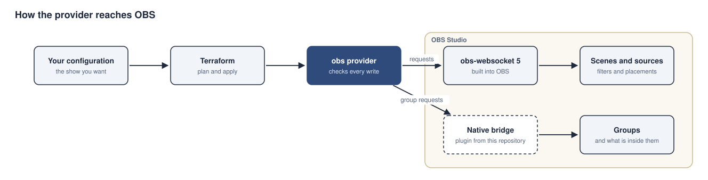
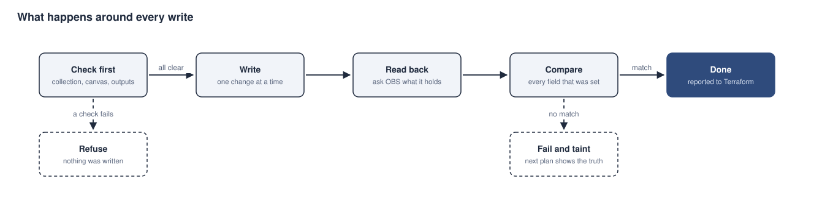
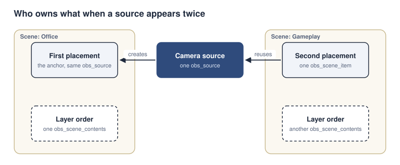

# Terraform Provider for OBS Studio

`terraform-provider-obs` manages an OBS Studio scene collection as Terraform resources: scenes, sources, groups, filters and the placements that arrange them. It talks to OBS over obs-websocket 5 and, for the group operations that obs-websocket does not expose, through a small native plugin that ships in this repository. Every write is read back from OBS before it is reported as done, and the provider refuses to write while OBS is streaming or recording.



## Documentation

The full reference is on the Terraform Registry, starting at [the provider configuration](https://registry.terraform.io/providers/DigiBugCat/obs/latest/docs).

- [Getting Started](https://registry.terraform.io/providers/DigiBugCat/obs/latest/docs/guides/getting-started) builds a first scene with a source and a filter.
- [Ownership, Placements and Ordering](https://registry.terraform.io/providers/DigiBugCat/obs/latest/docs/guides/ownership-and-ordering) explains anchors, extra placements and layer order.
- [Groups and the Native Bridge](https://registry.terraform.io/providers/DigiBugCat/obs/latest/docs/guides/groups) covers the group resources and the native plugin they need.
- [Filters and Plugin Sources](https://registry.terraform.io/providers/DigiBugCat/obs/latest/docs/guides/filters-and-plugins) covers generic and typed filters and plugin kinds.
- [Importing an Existing Collection](https://registry.terraform.io/providers/DigiBugCat/obs/latest/docs/guides/importing) brings existing scenes and sources under management.
- [How Writes Are Verified](https://registry.terraform.io/providers/DigiBugCat/obs/latest/docs/guides/verified-writes) describes the checks around every write.
- [Troubleshooting](https://registry.terraform.io/providers/DigiBugCat/obs/latest/docs/guides/troubleshooting) lists the refusals you are most likely to meet.

## Use

Declare the provider and run `terraform init`:

```terraform
terraform {
  required_providers {
    obs = { source = "digibugcat/obs" }
  }
}

# Connects to obs-websocket on the local machine.
# With no password set, the provider reads the credentials OBS itself stores.
provider "obs" {
  host = "127.0.0.1"
  port = 4455
}
```

## Requirements

- OBS Studio with obs-websocket 5 enabled; the provider is verified against OBS 32.2.2 with obs-websocket 5.7.4.
- A base canvas of 1920x1080, or another size set in the provider block.
- Terraform 1.5 or later.
- The native bridge plugin from `native-bridge`, only for group resources, which today means macOS on Apple silicon.

## How a Write Works

Before it writes, the provider checks that the right scene collection is active, that the canvas has the expected size and that nothing is streaming or recording. After it writes, it reads the object back and reports success only when every field matches.



## Who Owns What

A source resource owns the source and its first placement, called the anchor. Each further placement is an `obs_scene_item`, and one `obs_scene_contents` per scene declares the layer order.



## Resources

| Resource | Manages |
|---|---|
| [`obs_collection_seed`](https://registry.terraform.io/providers/DigiBugCat/obs/latest/docs/resources/collection_seed) | Creates a new, empty scene collection file while OBS is closed, in the form the group resources require. |
| [`obs_color_filter`](https://registry.terraform.io/providers/DigiBugCat/obs/latest/docs/resources/color_filter) | Manages one Color Correction filter with typed attributes for hue and opacity. |
| [`obs_filter`](https://registry.terraform.io/providers/DigiBugCat/obs/latest/docs/resources/filter) | Manages one filter of any installed kind on a source, scene or group, with the settings you choose to manage. |
| [`obs_group`](https://registry.terraform.io/providers/DigiBugCat/obs/latest/docs/resources/group) | Manages one group inside a scene: the group itself and its placement in that scene. |
| [`obs_group_graph`](https://registry.terraform.io/providers/DigiBugCat/obs/latest/docs/resources/group_graph) | Manages a whole group as one resource: the group, its placement in the scene, and an ordered list of image children with their placements. |
| [`obs_group_input`](https://registry.terraform.io/providers/DigiBugCat/obs/latest/docs/resources/group_input) | Manages one image source that is created directly inside a group, with its placement there. |
| [`obs_group_source`](https://registry.terraform.io/providers/DigiBugCat/obs/latest/docs/resources/group_source) | Manages one input of any installed kind that is created directly inside a group, with its placement there. |
| [`obs_input`](https://registry.terraform.io/providers/DigiBugCat/obs/latest/docs/resources/input) | Manages one image source, with typed attributes for its file, and its first placement in a scene. |
| [`obs_media_input`](https://registry.terraform.io/providers/DigiBugCat/obs/latest/docs/resources/media_input) | Manages one media source that plays a local file, with typed playback settings, and its first placement in a scene. |
| [`obs_move_source_filter`](https://registry.terraform.io/providers/DigiBugCat/obs/latest/docs/resources/move_source_filter) | Manages one Move Source filter from the Move plugin, which animates a placement to a target position, scale and rotation. |
| [`obs_move_value_filter`](https://registry.terraform.io/providers/DigiBugCat/obs/latest/docs/resources/move_value_filter) | Manages one Move Value filter from the Move plugin, which animates one numeric setting to a target value. |
| [`obs_plugin`](https://registry.terraform.io/providers/DigiBugCat/obs/latest/docs/resources/plugin) | Installs one OBS plugin from a manifest that pins every file by SHA-256, and records the installation in state. |
| [`obs_scene`](https://registry.terraform.io/providers/DigiBugCat/obs/latest/docs/resources/scene) | Manages one scene in an OBS scene collection. |
| [`obs_scene_contents`](https://registry.terraform.io/providers/DigiBugCat/obs/latest/docs/resources/scene_contents) | Declares the complete, ordered list of placements in one scene or group. |
| [`obs_scene_item`](https://registry.terraform.io/providers/DigiBugCat/obs/latest/docs/resources/scene_item) | Manages one additional placement of an existing source in a scene or group: its visibility, stacking position and transform. |
| [`obs_source`](https://registry.terraform.io/providers/DigiBugCat/obs/latest/docs/resources/source) | Manages one OBS input of any installed kind, the settings you choose to manage, and its first placement in a scene. |

## Development

```shell
make build
make test
make vet
make docs
make docs-check
```

Tests run offline against scripted obs-websocket fakes. The files under `docs` and the generated examples are rendered by `make docs` from the canvases in `tools/easel/canvas` and are never edited by hand. Text is laid one sentence at a time with the easel, which checks every name it mentions against the provider schema and source.

Releases are cut by pushing a version tag, and the release workflow builds and signs the archives that the Registry expects.

## License

Mozilla Public License 2.0.
